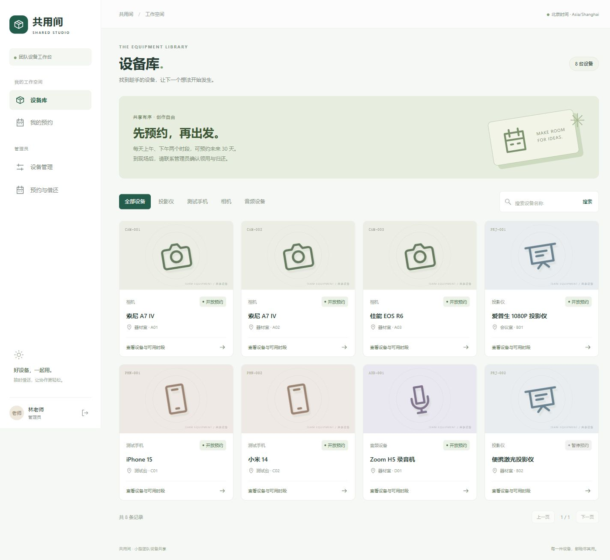
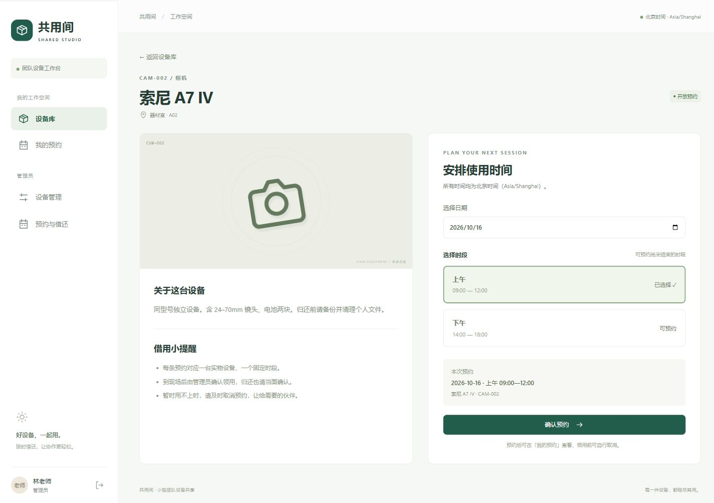
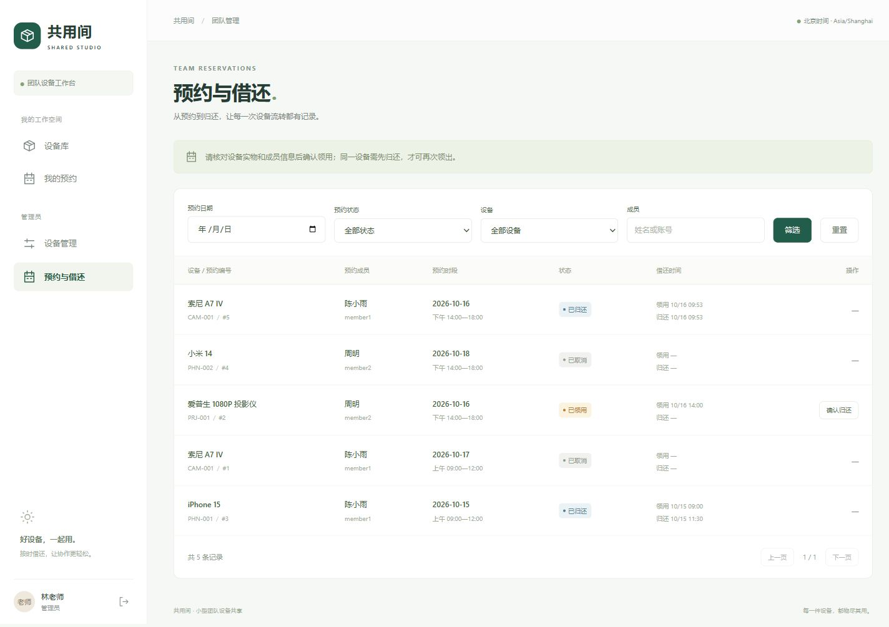
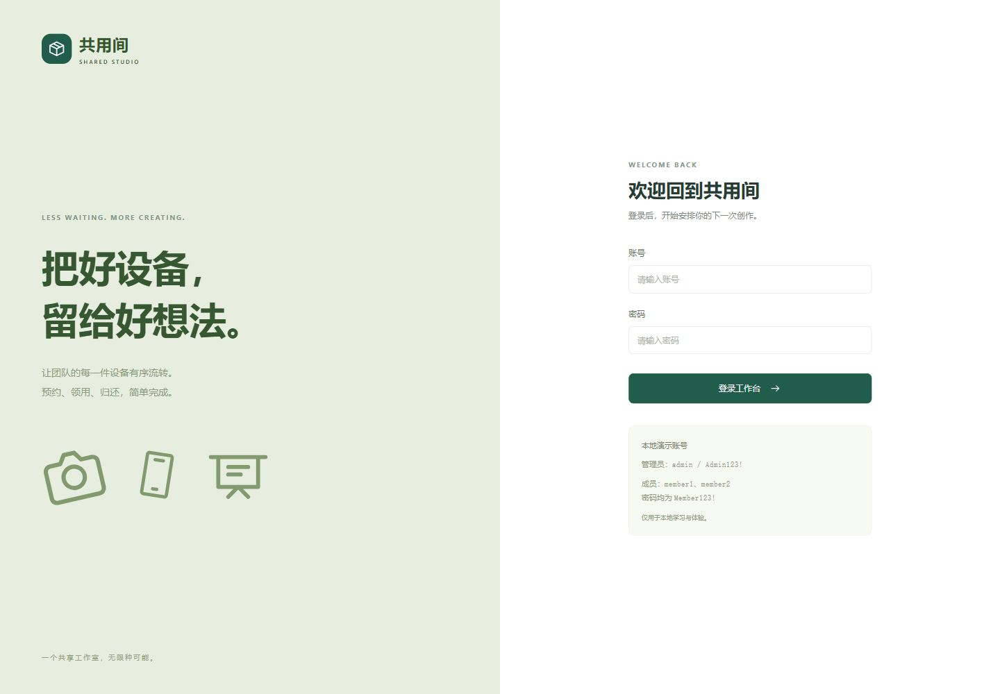

<div align="center">

# 共用间 · Shared Studio

**从预约到归还，让团队的每一件设备有序流转。**

一个用来学习 React、Spring Boot 和 MySQL 的完整前后端项目。


[快速启动](#快速启动) · [界面预览](#界面预览) · [学习路线](docs/learning-guide.md) · [业务与并发](docs/business-rules.md)

</div>

共用间面向小型团队的相机、投影仪、测试手机和音频设备共享：成员查找设备、选择时段并预约，管理员维护设备、确认领用和归还。

项目使用 React 函数组件与 Hooks、Spring Boot 单体后端和显式 SQL。你可以沿着一次预约，读懂**页面状态 → HTTP 请求 → 登录鉴权 → 业务事务 → 数据库约束**，并用真实 MySQL 测试验证并发冲突。



## 快速启动

准备 **Git、Node.js 22.12+（本次验证使用 24）和 Docker Compose v2**。推荐让 Docker 运行 MySQL 与 Java 后端，本机只启动前端，无需安装 Java / Maven。

**1. 获取项目，启动数据库和后端**

```bash
git clone https://github.com/HHN224/equipment-booking.git
cd equipment-booking
cp .env.example .env
docker compose --profile app up -d mysql backend
docker compose logs -f backend
```

Windows PowerShell 将 `cp .env.example .env` 换为 `Copy-Item .env.example .env`。已有 `.env` 时跳过复制。

首次启动需要下载镜像和 Maven 依赖。日志出现 `Started EquipmentBookingApplication` 后，按 `Ctrl+C` 退出日志查看，服务仍在后台运行。

**2. 启动前端**

```bash
cd frontend
npm ci
npm run dev
```

**3. 打开 [localhost:5173](http://localhost:5173)，选择演示账号登录**

| 角色 | 账号 | 密码 | 可体验功能 |
| --- | --- | --- | --- |
| 管理员 | `admin` | `Admin123!` | 设备维护、领用归还，也可自行预约 |
| 成员 | `member1` / `member2` | `Member123!` | 设备查询、预约、取消与记录查询 |

首次启动自动创建 3 个账号、8 台设备和 4 条演示预约；重复启动保留已有数据。以上账号和 `.env.example` 密码仅供本地学习。

停止时，在前端终端按 `Ctrl+C`，然后回到项目根目录执行 `docker compose stop`；数据库数据会保留。

本地 Java 调试、自有 MySQL、端口配置和常见问题见 [开发指南](docs/development.md)。

## 可以学到什么

| 功能 | 对应技术 |
| --- | --- |
| 登录、退出与会话恢复 | React Context、Session Cookie、Spring Security、CSRF |
| 设备搜索、分类与分页 | 受控表单、Hooks、URL 查询参数、SQL 分页 |
| 按日期与上下午时段预约 | TypeScript 类型、前后端校验、业务时区 |
| 取消、领用与归还 | 状态转换、角色权限、条件更新 |
| 同一时段只能预约一次 | `@Transactional`、InnoDB 行锁、唯一约束 |
| 初始化与自动化验证 | Flyway、幂等初始化、MockMvc、真实 MySQL 集成测试 |

预约可取消，取消后释放时段；领用后由管理员确认归还，提前归还也保留原时段占用。完整规则和设计理由见 [业务规则与并发控制](docs/business-rules.md)。

## 界面预览

以下图片来自本地运行的真实项目，使用演示数据；日期和状态会随你的操作变化。

| 选择设备与预约时段 | 管理预约与借还 |
| --- | --- |
|  |  |

<details>
<summary>查看登录页</summary>



</details>

## 从哪里开始读代码

```text
equipment-booking/
├── backend/
│   └── src/
│       ├── main/java/com/example/equipment/  # auth、equipment、reservation 等业务模块
│       ├── main/resources/db/migration/     # 数据表、主键与外键约束
│       └── test/                            # 真实 MySQL 集成测试
├── docs/                                    # 开发、学习与测试文档
├── frontend/
│   └── src/
│       ├── components/                      # 弹窗、分页、设备编辑等组件
│       ├── views/                           # 登录、设备、预约与管理页面
│       ├── App.tsx                          # 路由与工作台布局
│       ├── api.ts                           # 请求、CSRF 与错误处理
│       ├── main.tsx                         # React 入口
│       ├── providers.tsx                    # 登录状态与短提示
│       ├── style.css                        # 按功能分区的样式与响应式规则
│       └── types.ts                         # 接口类型与展示文案
├── scripts/                                 # 本地后端启动、独立测试库验证
├── .env.example                             # 本地配置示例
└── compose.yaml                             # MySQL、后端和测试环境
```

建议先读 [代码学习路线](docs/learning-guide.md)，跟着“一次预约如何完成”逐层阅读，再看事务、锁和约束如何协作。

| 文档 | 内容 |
| --- | --- |
| [开发指南](docs/development.md) | 环境版本、本地启动、端口与常见问题 |
| [代码学习路线](docs/learning-guide.md) | 源码入口、请求链路、前端阅读与格式约定 |
| [业务规则与并发控制](docs/business-rules.md) | 状态流转、权限、事务与唯一约束 |
| [测试指南](docs/testing.md) | 格式检查、构建、MySQL 测试与验证记录 |
| [手工验收](docs/manual-checks.md) | 用三个演示账号体验完整流程 |

## 日常检查

在 `frontend` 目录执行：

```bash
npm run format        # 整理前端源码、HTML 与配置文件
npm run format:check  # 只检查，不修改文件
npm run build         # TypeScript 检查 + Vite 生产构建
```

在项目根目录执行 `bash scripts/test-mysql.sh`，使用独立的临时 MySQL 验证业务与并发规则（Windows 使用 Git Bash / WSL）。详见 [测试指南](docs/testing.md)。

本项目用于本地学习，暂未实现注册、找回密码、多组织、审批和自动通知；Session 存在后端内存，重启后需要重新登录。部署与后续扩展方向见 [已知限制](docs/business-rules.md#已知限制与后续学习方向)。
