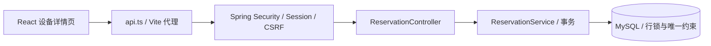

# 代码学习路线

[返回项目首页](../README.md) · [业务与并发](business-rules.md)

先启动项目，使用成员账号完成一次页面操作，再沿下面的路径阅读。暂时不需要学习额外的状态管理库或微服务框架。

## 1. 从 React 入口认识前端

| 顺序 | 文件 | 重点 |
| --- | --- | --- |
| 1 | [index.html](../frontend/index.html) → [main.tsx](../frontend/src/main.tsx) | HTML 挂载点、React 根节点、Router 与 Provider 的嵌套关系 |
| 2 | [App.tsx](../frontend/src/App.tsx) | 路由、工作台布局、`Outlet`、未登录跳转、管理员页面入口 |
| 3 | [providers.tsx](../frontend/src/providers.tsx) | Context 如何共享登录用户，刷新页面如何恢复会话，401 如何清除登录状态 |
| 4 | [types.ts](../frontend/src/types.ts) | 接口对象、分页泛型、状态联合类型、固定时区的时间展示 |
| 5 | [api.ts](../frontend/src/api.ts) | `fetch`、同源 Cookie、写请求获取 CSRF token、错误转换 |

前端路由限制负责页面体验，后端权限校验才是数据访问边界。

## 2. 按“状态 → 请求 → 事件 → 页面”阅读组件

页面通常从上到下分为四部分：

1. **状态和依赖**：`useState` 保存输入、结果、加载状态和错误；路由与 Context 提供共享信息。
2. **副作用**：`useEffect` 在页面加载、页码或已提交的筛选条件变化后请求数据。
3. **事件处理**：搜索、保存、预约等函数响应用户操作，并更新状态。
4. **JSX**：把状态转换为输入框、列表、提示和弹窗。

例如 [EquipmentListView.tsx](../frontend/src/views/EquipmentListView.tsx) 中，`name` 是正在输入的关键词，`appliedName` 是点击“搜索”后真正提交的关键词。分开保存可以避免每输入一个字就发送请求。

请求 Effect 中的 `active` 标记不取消 HTTP 请求，而是在清理时使旧响应失效：切换筛选条件或离开页面后，旧请求不能覆盖新结果。可以在浏览器降低网络速度，观察这个设计的作用。

| 页面 / 组件 | 阅读重点 |
| --- | --- |
| [LoginView.tsx](../frontend/src/views/LoginView.tsx) | 受控输入、提交状态、登录后的导航 |
| [EquipmentDetailView.tsx](../frontend/src/views/EquipmentDetailView.tsx) | 设备与日期窗口并行查询、切换日期、确认预约、冲突后刷新时段 |
| [ReservationsView.tsx](../frontend/src/views/ReservationsView.tsx) | 我的记录与管理记录共用页面，筛选与状态操作 |
| [EquipmentAdminView.tsx](../frontend/src/views/EquipmentAdminView.tsx) | 设备列表、打开编辑器、保存成功后刷新列表 |
| [EquipmentEditor.tsx](../frontend/src/components/EquipmentEditor.tsx) | 独立的新增/编辑表单，通过回调通知父页面 |
| [ConfirmDialog.tsx](../frontend/src/components/ConfirmDialog.tsx) | `children`、原生 `dialog`、提交期间禁用关闭 |
| [PaginationBar.tsx](../frontend/src/components/PaginationBar.tsx) | Props、页码边界、回调事件 |

## 3. 跟踪一次预约的完整链路

| 步骤 | 源码 | 要回答的问题 |
| --- | --- | --- |
| 选时段并提交 | [EquipmentDetailView.tsx](../frontend/src/views/EquipmentDetailView.tsx) 的 `book` | 页面发送了哪些字段？为什么提交失败后重新查询占用？ |
| 验证登录与请求 | [SecurityConfig.java](../backend/src/main/java/com/example/equipment/config/SecurityConfig.java)、[AuthController.java](../backend/src/main/java/com/example/equipment/auth/AuthController.java) | Session 与 CSRF 各解决什么问题？ |
| 接收参数 | [ReservationController.java](../backend/src/main/java/com/example/equipment/reservation/ReservationController.java) | 参数校验在哪里发生？用户身份从哪里来？ |
| 执行业务 | [ReservationService.java](../backend/src/main/java/com/example/equipment/reservation/ReservationService.java) 的 `book` | 为什么先锁设备，再检查日期和状态，最后写预约与占用？ |
| 保证唯一 | [V1__schema.sql](../backend/src/main/resources/db/migration/V1__schema.sql) | `slot_occupancy` 和 `active_loan` 的主键分别保护什么？ |
| 反馈结果 | [ApiExceptionHandler.java](../backend/src/main/java/com/example/equipment/common/ApiExceptionHandler.java)、[ReservationsView.tsx](../frontend/src/views/ReservationsView.tsx) | 业务冲突如何变成 HTTP 409 和中文提示？ |
| 验证设计 | [BookingIntegrationTest.java](../backend/src/test/java/com/example/equipment/BookingIntegrationTest.java) | 并发测试为什么还要断言数据库里的行数与状态？ |

再沿着 `cancel`、`pickup`、`returnEquipment` 阅读剩余状态转换，结合 [并发控制说明](business-rules.md#为什么并发控制有效) 理解事务边界。

## 4. 保持代码可读

- 每个状态使用独立声明，避免把多个 `useState` 用逗号串在一起。
- 条件分支写花括号；不同职责的函数、Effect 和 JSX 返回区之间留空行。
- JSX 的多个属性分行书写，由 Prettier 统一处理缩进、引号和换行。
- 注释解释设计原因，例如旧请求失效、服务器日期和冲突处理，不逐行复述代码。
- 页面负责列表和页面状态，可独立理解的表单放入 `components/`，通过 Props 和回调协作。
- [style.css](../frontend/src/style.css) 以注释划分基础、布局、设备库、通用控件、预约、表格、弹窗、登录与响应式样式；后面的规则仍遵循原来的层叠顺序。

在 `frontend` 目录运行 `npm run format` 格式化，提交前运行 `npm run format:check` 与 `npm run build`。格式化可以处理排版，但职责划分、变量命名和注释仍需要人工判断。

## 5. 用小练习验证理解

1. 在开发者工具中观察搜索和翻页的请求，解释输入状态与查询状态的区别。
2. 用两个成员同时预约同一时段，比较页面快照与最终提交结果，查看 409 响应。
3. 对照 `slot_occupancy`，解释为什么取消释放时段，而归还保留占用。
4. 阅读初始化代码 [DemoDataInitializer.java](../backend/src/main/java/com/example/equipment/config/DemoDataInitializer.java)，解释重复启动为什么不会覆盖数据。

操作流程见 [手工验收](manual-checks.md)，自动化运行方式见 [测试指南](testing.md)。
